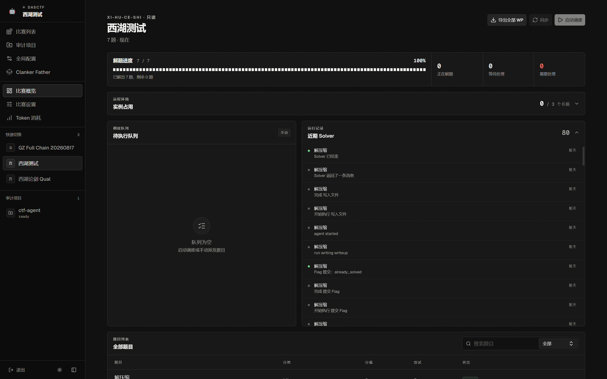
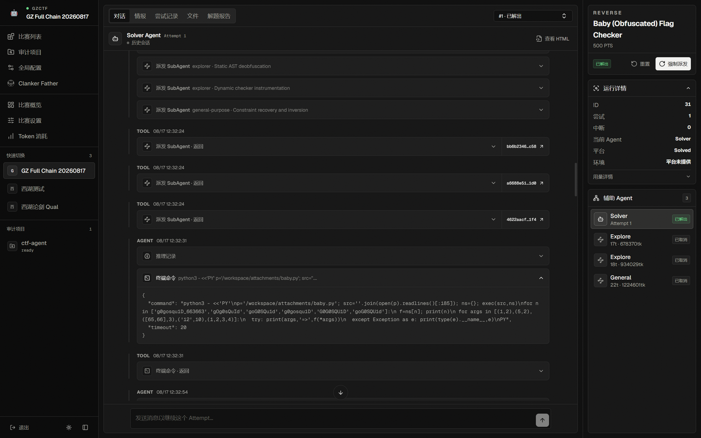
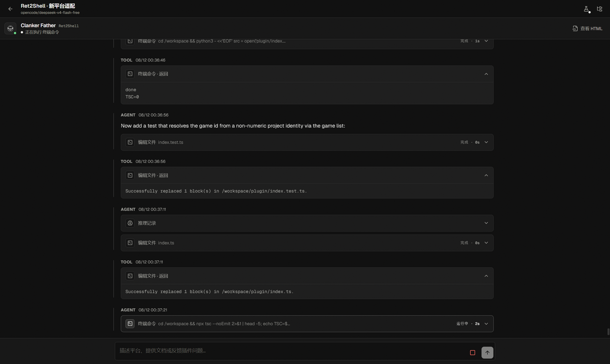

# JYFF Agent

JYFF Agent 是一套 Agent for InfoSec 的解决方案，提供基于 pi agent 的可拓展、可持续化的 CTF 自动解题调度和基于 codex-security 的代码审计。

> [!CAUTION]
> **免责声明**
>
> JYFF Agent 仅用于经授权的安全研究、教学、内部验证和 CTF 环境。不要在未获得明确授权的系统上使用 JYFF Agent。使用者需自行确保遵守适用法律法规、授权范围、测试规则和第三方服务条款。JYFF Agent 的作者和贡献者不对因使用或滥用本项目造成的未授权访问、服务中断、数据丢失、法律后果或其它损害负责。JYFF Agent 可能执行由模型驱动的工具和 shell 命令；请在采取行动前审查目标、命令、输出和生成的 artifacts。

## 截图

<table>
  <tr>
    <td align="center">
      <br />
      赛题概览
    </td>
    <td align="center">
      <br />
      配置界面
    </td>
    <td align="center">
      <br />
      代码审计
    </td>
  </tr>
  <tr>
    <td align="center">
      <br />
      比赛概览
    </td>
    <td align="center">
      <br />
      解题界面
    </td>
    <td align="center">
      <br />
      Clanker Father
    </td>
  </tr>
</table>

## 功能

- **多 Project 管理**：为不同比赛隔离平台配置、凭据、题目 workspace、运行记录和调度器。
- **平台接入**：内置 CTFd、DASCTF Pro、GZCTF 和 Ret2Shell，统一提供题目、公告、附件、Flag 提交及可选远程环境能力；公告可匹配题目并由用户审核后投递。
- **模型池**：全局维护 Pi Models registry 和 Provider 凭据，再按 Project 为 Solver、TLDR、SubAgent 角色绑定模型；支持自定义 Provider 和模型发现。
- **批量调度**：支持自动队列、手动派发、队列排序、并发限制、重试、失败阻塞和平台故障恢复。
- **Solver 运行环境**：每次 Run 使用独立 Pi JSONL 会话和 Docker sandbox，能够读取附件、操作 workspace、调用题目能力并提交 Flag。
- **协作解题**：Solver 可派发 `general-purpose`、`explorer`、`fuzzer` SubAgent；多个 Agent 共享题目 sandbox，主 Solver 统一维护黑板，所有 worker 拥有独立会话及工具边界。
- **调查状态**：黑板保存 Evidence 和待验证 Opportunity；TLDR 生成接管摘要；解题成功后可生成并校验 Writeup。
- **Web Access**：按全局 allowlist 启用搜索、页面读取和内容提取，支持 SSRF 限制及可选自动摘要。
- **Clanker Father**：在独立工作区中生成或修复平台插件，通过 Docker Validation Gate 验证后再安装 revision。
- **实时 WebUI**：通过 HTTP API 和 SSE 展示 Project、Run、SubAgent、Father 会话及工具调用状态，支持对话、暂停、取消、重试和 HTML 导出。

## 工作原理

```text
React WebUI
    │ HTTP / SSE
    ▼
Hono API ── 鉴权、校验、快照与事件
    ▼
ControlPlane ── Project 注册表、平台连接、生命周期
    ▼
Project ── RunStore、workspace、黑板、SubAgent、远程环境租约
    ▼
ContestScheduler / ContestRunner
    ▼
Pi Solver ── ChallengeCapability ── PlatformPlugin
    │
    ├── Docker sandbox：命令、文件和工具
    ├── SubAgent：共享 sandbox，独立 Pi session
    └── RunStore：SQLite 状态、事件、usage 和快照
```

Project 是隔离边界。Solver 只拿到当前题目的 `ChallengeCapability`，不能直接访问整个比赛平台；调度器把运行状态写入 RunStore，服务重启后从 SQLite、JSONL session 和 workspace 恢复。平台不可用时，控制面保留最后成功快照并将 Project 置为只读，避免在未知状态下继续提交或启动 Solver。

## 技术栈

| 层           | 技术                                                                 |
| ------------ | -------------------------------------------------------------------- |
| 语言与运行时 | TypeScript、ESM、Node.js `>=22.19.0`                                 |
| 工作区与构建 | pnpm `11.20.0`、Vite+ `0.2.8`、Vite/Rolldown、Oxfmt/Oxlint           |
| 后端         | Hono、`@hono/node-server`、Node `sqlite`、SSE                        |
| 前端         | React 19、React Router 7、Tailwind CSS 4、Radix UI、dnd-kit、Iconify |
| Agent        | Pi Agent Core、Pi AI、Pi Coding Agent                                |
| 执行隔离     | Docker Engine、独立 Solver 工具镜像                                  |
| 平台         | CTFd REST API、GZCTF API、可验证 PlatformPlugin 扩展                 |

## 安装与开发启动

### 前置条件

- Node.js `>=22.19.0`
- pnpm `11.20.0`
- Docker Engine 或 Docker Desktop，并允许当前用户运行 Docker CLI

首次安装并启动：

```bash
vp install
vp run build:sandbox
vp run webui
```

`build:sandbox` 创建 `ctf-agent-solver:latest`、`ctf-agent-audit:latest`，并拉取固定 digest 的 LiteLLM Responses bridge 镜像。Solver、Father 和插件验证使用 solver 镜像；代码审计会按 Run 启动隔离的 LiteLLM sidecar。没有这些镜像时 WebUI 仍可能启动，但相关执行操作会被明确阻止。

`vp run webui` 先执行前端构建，再运行 `apps/backend/src/main.ts`。默认监听 `0.0.0.0:3000`，以终端输出的地址访问 WebUI。部署在公网请务必在全局配置打开账号密码登录鉴权。

没有可用 Solver 模型时，仍可以查看本地快照、历史 Run 和 workspace，但调度、派发及实时解题操作会被禁用。

### 直接运行后端

```bash
vp build
node --experimental-transform-types apps/backend/src/main.ts \
  --root ./data \
  --host 127.0.0.1 \
  --port 3000
```

可用参数包括 `--root`、`--host`、`--port`、`--poll-interval-ms`、`--max-concurrent`、`--max-attempts`、`--max-session-interruptions`、`--challenge-timeout-ms`、`--retry-delay-ms`、`--workspace-volume`、`--auth-file` 和 `--auto-start`。默认值和取值上限见 `apps/backend/src/main.ts` 的 `parseOptions()`。

## Docker 部署

生产式 WebUI 使用多阶段镜像，构建阶段安装依赖并生成前端产物，运行阶段只保留 Node.js、生产依赖、前端产物和 Docker CLI：

```bash
vp run build:sandbox
docker compose up --build -d
```

默认只启动 WebUI，ShellPoop 反弹 Shell 服务是可选功能，不需要准备外部 `../shellpoop` 仓库。如果需要启用它：

```bash
docker compose --profile shellpoop up --build -d
```

ShellPoop 默认从 `../shellpoop` 构建，也可以通过 `SHELLPOOP_BUILD_CONTEXT` 指定服务仓库路径。

### ShellPoop 插件配置

[ShellPoop](https://github.com/fressive/shellpoop) 是可选的反弹 Shell 管理服务，仅用于已获授权的 CTF、渗透测试或红队环境。

准备上游仓库并启动服务：

```bash
git clone https://github.com/fressive/shellpoop.git ../shellpoop

# 必须填写目标主机能够访问到的 IP 或域名；公网/NAT 场景不要留空。
SHELLPOOP_ADVERTISE_HOST=ctf.example.com \
  docker compose --profile shellpoop up --build -d
```

需要 API 密钥时，在项目根目录的 `.env`（不要提交）中加入 `SHELLPOOP_API_KEY=<随机长密钥>`，或在启动命令前导出该环境变量。如果仓库不在 `../shellpoop`，通过 `SHELLPOOP_BUILD_CONTEXT=/path/to/shellpoop` 指定构建目录。Compose 默认提供以下网络：

- WebUI 容器访问 ShellPoop：`http://shellpoop:8000`。
- 宿主机访问 REST API：`http://127.0.0.1:8000`。
- 反弹 Shell 监听端口：`20000-21000`，目标主机和防火墙必须允许回连这些端口。

在 WebUI 的“全局设置 → ShellPoop”中配置并保存：

- **启用**：打开插件。
- **服务地址（baseUrl）**：Compose 部署填写 `http://shellpoop:8000`；WebUI 和 ShellPoop 都运行在宿主机时填写 `http://127.0.0.1:8000`。容器内不要将 `127.0.0.1` 误填为 ShellPoop 地址。
- **请求超时**：单位为毫秒，默认 `15000`，最大 `600000`。
- **API 密钥**：如果 ShellPoop 设置了 `SHELLPOOP_API_KEY`，这里必须填写同一个值。密钥只保存到 CTF Agent 的 SecretStore，不会显示在配置快照中。

## 数据目录

`--root` 默认为当前工作目录。控制面状态位于 `<root>/.ctf-agent`：

```text
.ctf-agent/
├── project-registry.json          # Project 索引、目录映射、归档状态
├── project-config.json            # 根/兼容 Project 的平台配置
├── runtime-config.json            # 根 Project 的模型绑定和调度参数
├── runs.sqlite                    # 根 Project 的 RunStore
├── runs/<run-id>/                 # Pi session、SubAgent session 和运行产物
├── challenges/                    # 根 Project 的题目 workspace
├── projects/<32hex>/              # 其他 Project 的独立状态目录
├── model-config.json              # 全局模型池 v3
├── auth.json                      # Pi Provider 登录状态
├── web-access.json                # Web Access allowlist 和 SSRF 配置
├── shellpoop.json                 # ShellPoop 反弹 shell 插件配置
├── scheduler-config.json          # 全局调度默认值
├── global-config.json             # WebUI 登录配置
├── secrets.json                   # SecretStore，禁止提交
├── father/sessions/<session-id>/  # Father JSONL 和插件工作区
└── extensions/<plugin-id>/        # 已验证插件的 revision 和 active 指针
```

新建的非根 Project 使用 `projects/<Project ID 的 SHA-256 前 32 位十六进制字符>`，防止 ID 直接影响目录结构。

删除 Project 会删除其状态目录；重置 Solver 只删除 `runs.sqlite`、`runs/` 和 `challenges/`，保留 Project 配置、runtime 配置和平台凭据。

独立调用 `Project.open()` 时，项目配置来源为 `<project-root>/.pi/ctf-config.json`；WebUI 使用 ControlPlane 的 Project 注册表。

## 验证与测试

CI 使用以下顺序：

```bash
vp check
vp run typecheck
vp test
vp build
```

单文件测试：

```bash
vp test run packages/core/test/runner/contest-runner.test.ts
vp test run apps/backend/test/projects.test.ts -t "测试名称"
```

测试使用 `vite-plus/test`，统一配置位于根目录 `vite.config.ts`，测试文件位于各包的 `test/` 目录。

平台 live contract 默认跳过，设置 `CTFD_DEMO_TOKEN` 可运行 CTFd demo 测试，设置 `GZCTF_LIVE=1` 可运行 GZCTF live 测试。

修改 Dockerfile 还应执行：

```bash
docker build --check -f apps/backend/Dockerfile .
```

## 代码导航

| 路径                                         | 作用                                                                   |
| -------------------------------------------- | ---------------------------------------------------------------------- |
| `apps/backend/src/main.ts`                   | 初始化 SecretStore、模型池、ControlPlane、Scheduler、Father 并启动服务 |
| `apps/backend/src/http/app.ts`               | 组装鉴权、全局/Project 路由、SSE 和前端静态资源                        |
| `apps/backend/src/http/routes/`              | Project、Scheduler、Challenge、Run、Model、Father 等 API               |
| `apps/frontend/src/main.tsx`                 | React Router、鉴权初始化和页面懒加载入口                               |
| `packages/core/src/control-plane/`           | Project 注册表、SecretStore 和多 Project 生命周期                      |
| `packages/core/src/project/`                 | 单 Project、workspace、远程环境和 Solver 装配                          |
| `packages/core/src/orchestration/`           | `ContestScheduler`、`ContestRunner` 和退出/重试策略                    |
| `packages/core/src/persistence/run-store.ts` | SQLite schema、Run、队列、黑板、公告和快照                             |
| `packages/agents/src/`                       | BaseAgent、Solver、SubAgent、Father 和工具                             |
| `packages/platform/src/`                     | PlatformPlugin 契约、CTFd、GZCTF、注册表和验证器                       |
| `packages/sandbox/src/`                      | DockerSandbox 和容器内 ExecutionEnv                                    |
| `packages/web-access/src/`                   | 搜索、页面读取、GitHub/PDF/视频内容提取                                |
| `packages/shellpoop/src/`                    | 反弹 shell 管理（ShellPoop REST API 的 Agent 工具）                    |
| `packages/prompts/src/`                      | Solver、SubAgent、Father、TLDR 和 compaction 提示词                    |

## 文档

- [系统架构与实现](docs/architecture.md)
- [容器配发与远程环境生命周期](docs/remote-environments.md)
- [调度原则与执行许可](docs/scheduling.md)
- [黑板协议](docs/blackboard-spec.md)
- [平台插件与 Validation Gate](docs/platform-plugins.md)
- [SubAgent 生命周期](docs/subagents.md)
- [Father 插件开发提示](packages/agents/skills/extension-authoring/SKILL.md)
- [Web Access 上游固定与边界](packages/web-access/UPSTREAM_PIN.md)
