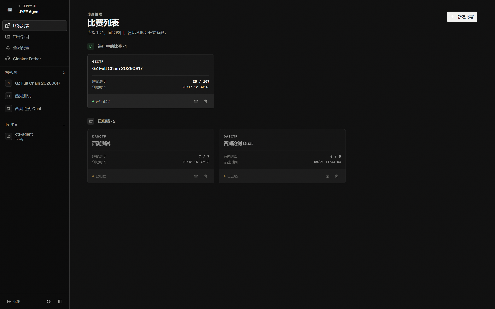
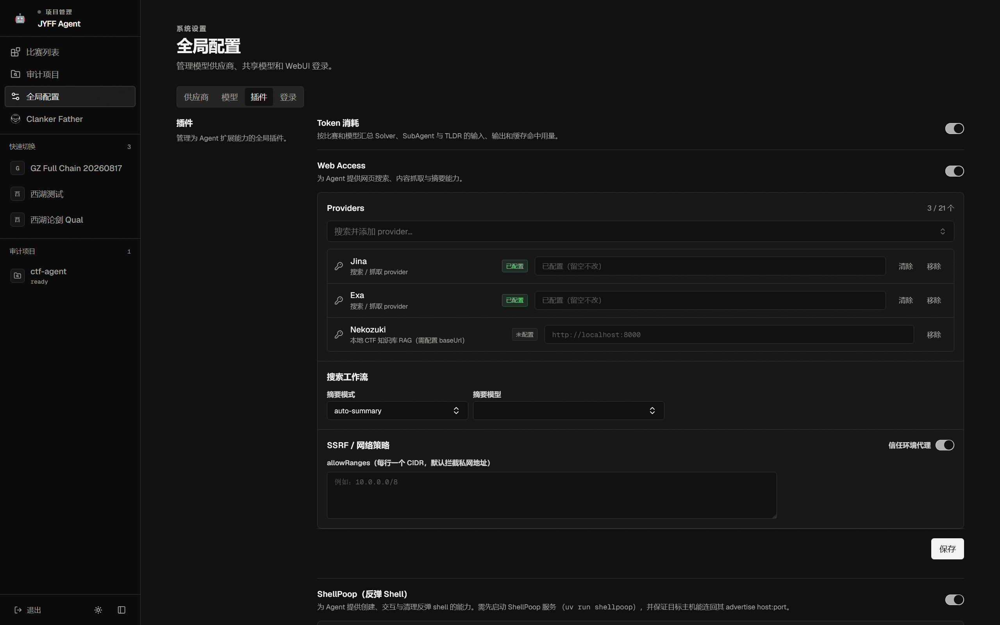
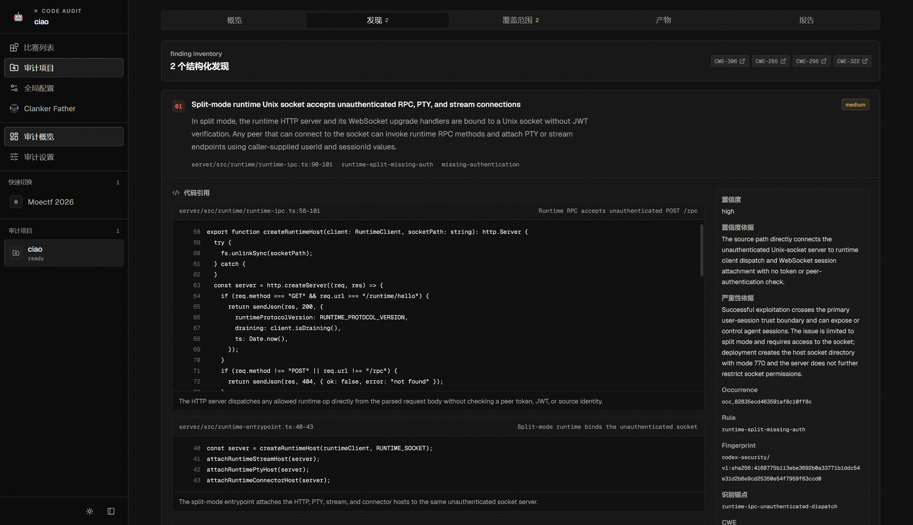

# JYFF Agent

JYFF Agent 是一套 Agent for InfoSec 的解决方案，提供基于 pi agent 的可拓展、可持续化的 CTF 自动解题调度和基于 codex-security 的代码审计。

> [!CAUTION]
> **免责声明**
>
> JYFF Agent 仅用于经授权的安全研究、教学、内部验证和 CTF 环境。不要在未获得明确授权的系统上使用 JYFF Agent。使用者需自行确保遵守适用法律法规、授权范围、测试规则和第三方服务条款。JYFF Agent 的作者和贡献者不对因使用或滥用本项目造成的未授权访问、服务中断、数据丢失、法律后果或其它损害负责。JYFF Agent 可能执行由模型驱动的工具和 shell 命令；请在采取行动前审查目标、命令、输出和生成的 artifacts。

## 功能

### 多 Project 管理，多平台接入，基于 pi 的插件生态

<table>
  <tr>
    <td align="center">
      <br />
      比赛概览
    </td>
    <td align="center">
      <br />
      配置界面
    </td>
  </tr>
</table>

### 批量调度、多 agents 协作解题

<table>
  <tr>
    <td align="center">
      <br />
      赛题概览
    </td>
    <td align="center">
      <br />
      解题界面
    </td>
  </tr>
</table>

### 自动适配 CTF 平台、白盒代码审计

<table>
  <tr>
    <td align="center">
      <br />
      代码审计
    </td>
    <td align="center">
      <br />
      Clanker Father
    </td>
  </tr>
</table>

## 技术栈

| 层           | 技术                                                                 |
| ------------ | -------------------------------------------------------------------- |
| 语言与运行时 | TypeScript、ESM、Node.js `>=22.19.0`                                 |
| 工作区与构建 | pnpm `11.20.0`、Vite+ `0.2.8`、Vite/Rolldown、Oxfmt/Oxlint           |
| 后端         | Hono、`@hono/node-server`、Node `sqlite`、SSE                        |
| 前端         | React 19、React Router 7、Tailwind CSS 4、Radix UI、dnd-kit、Iconify |
| Agent        | Pi Agent Core、Pi AI、Pi Coding Agent                                |
| 执行隔离     | Docker Engine、独立 Solver 工具镜像                                  |
| 平台         | CTFd REST API、GZCTF API、可验证 PlatformPlugin 扩展                 |

## 安装与启动

### 前置条件

- Node.js `>=22.19.0`
- pnpm `11.20.0`
- Docker Engine 或 Docker Desktop，并允许当前用户运行 Docker CLI

首次安装并启动：

```bash
vp install
vp run build:sandbox
vp run webui
```

这样你就可以启动 JYFF Agent 的 webui 体验完整功能了，我们也推荐你通过 docker compose 来快速、稳定地部署我们的 Agent

```bash
vp run build:sandbox
docker compose up --build -d
```

默认只启动 WebUI，ShellPoop 反弹 Shell 服务是可选功能，不需要准备外部 `../shellpoop` 仓库。如果需要启用它：

```bash
docker compose --profile shellpoop up --build -d
```

ShellPoop 默认从 `../shellpoop` 构建，也可以通过 `SHELLPOOP_BUILD_CONTEXT` 指定服务仓库路径。

### ShellPoop 插件配置

[ShellPoop](https://github.com/fressive/shellpoop) 是可选的反弹 Shell 管理服务，仅用于已获授权的 CTF、渗透测试或红队环境。

准备上游仓库并启动服务：

```bash
git clone https://github.com/fressive/shellpoop.git ../shellpoop

# 必须填写目标主机能够访问到的 IP 或域名；公网/NAT 场景不要留空。
SHELLPOOP_ADVERTISE_HOST=ctf.example.com \
  docker compose --profile shellpoop up --build -d
```

需要 API 密钥时，在项目根目录的 `.env`（不要提交）中加入 `SHELLPOOP_API_KEY=<随机长密钥>`，或在启动命令前导出该环境变量。

如果仓库不在 `../shellpoop`，通过 `SHELLPOOP_BUILD_CONTEXT=/path/to/shellpoop` 指定构建目录。Compose 默认提供以下网络：

- WebUI 容器访问 ShellPoop：`http://shellpoop:8000`。
- 宿主机访问 REST API：`http://127.0.0.1:8000`。
- 反弹 Shell 监听端口：`20000-21000`，目标主机和防火墙必须允许回连这些端口。

在 WebUI 的“全局设置 → ShellPoop”中配置并保存：

- **启用**：打开插件。
- **服务地址（baseUrl）**：Compose 部署填写 `http://shellpoop:8000`；WebUI 和 ShellPoop 都运行在宿主机时填写 `http://127.0.0.1:8000`。容器内不要将 `127.0.0.1` 误填为 ShellPoop 地址。
- **请求超时**：单位为毫秒，默认 `15000`，最大 `600000`。
- **API 密钥**：如果 ShellPoop 设置了 `SHELLPOOP_API_KEY`，这里必须填写同一个值。密钥只保存到 CTF Agent 的 SecretStore，不会显示在配置快照中。

## 代码导航

| 路径                                         | 作用                                                                   |
| -------------------------------------------- | ---------------------------------------------------------------------- |
| `apps/backend/src/main.ts`                   | 初始化 SecretStore、模型池、ControlPlane、Scheduler、Father 并启动服务 |
| `apps/backend/src/http/app.ts`               | 组装鉴权、全局/Project 路由、SSE 和前端静态资源                        |
| `apps/backend/src/http/routes/`              | Project、Scheduler、Challenge、Run、Model、Father 等 API               |
| `apps/frontend/src/main.tsx`                 | React Router、鉴权初始化和页面懒加载入口                               |
| `packages/core/src/control-plane/`           | Project 注册表、SecretStore 和多 Project 生命周期                      |
| `packages/core/src/project/`                 | 单 Project、workspace、远程环境和 Solver 装配                          |
| `packages/core/src/orchestration/`           | `ContestScheduler`、`ContestRunner` 和退出/重试策略                    |
| `packages/core/src/persistence/run-store.ts` | SQLite schema、Run、队列、黑板、公告和快照                             |
| `packages/agents/src/`                       | BaseAgent、Solver、SubAgent、Father 和工具                             |
| `packages/platform/src/`                     | PlatformPlugin 契约、CTFd、GZCTF、注册表和验证器                       |
| `packages/sandbox/src/`                      | DockerSandbox 和容器内 ExecutionEnv                                    |
| `packages/web-access/src/`                   | 搜索、页面读取、GitHub/PDF/视频内容提取                                |
| `packages/shellpoop/src/`                    | 反弹 shell 管理（ShellPoop REST API 的 Agent 工具）                    |
| `packages/prompts/src/`                      | Solver、SubAgent、Father、TLDR 和 compaction 提示词                    |

## 文档

- [系统架构与实现](docs/architecture.md)
- [容器配发与远程环境生命周期](docs/remote-environments.md)
- [调度原则与执行许可](docs/scheduling.md)
- [黑板协议](docs/blackboard-spec.md)
- [平台插件与 Validation Gate](docs/platform-plugins.md)
- [SubAgent 生命周期](docs/subagents.md)
- [Father 插件开发提示](packages/agents/skills/extension-authoring/SKILL.md)
- [Web Access 上游固定与边界](packages/web-access/UPSTREAM_PIN.md)
